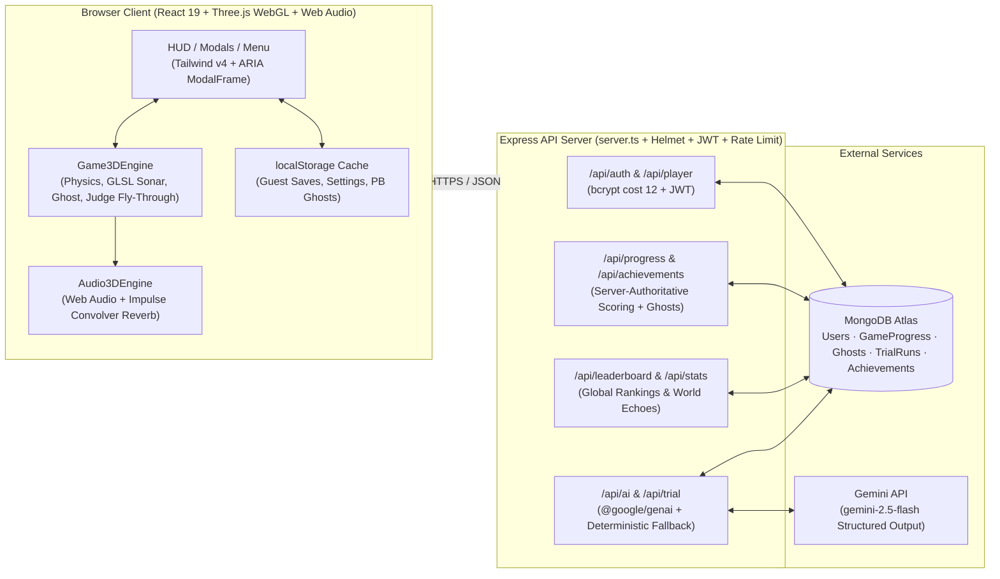

# ECHOES OF THE DARK

> **"In a world without light, every echo tells a story."** — *Every echo reveals a forgotten world.*

[](https://github.com/fahim1252375-maker/echoes-of-the-dark-3/actions/workflows/ci.yml)


A full-stack third-person 3D acoustic-spatial puzzle-adventure browser game built with **Three.js**, **React 19**, **TypeScript**, **Express.js**, **MongoDB Atlas**, and **Gemini AI (`@google/genai`)**.

**[View source on GitHub](https://github.com/fahim1252375-maker/echoes-of-the-dark-3) · [View Devpost project](https://devpost.com/software/echoes-of-the-dark)**

## Project at a glance

Explore a forgotten underground civilization where sound is your only way to see. Use the Echo Core to reveal hidden paths, solve resonance puzzles, avoid sound-sensitive sentinels, and uncover lost memories.

| Area | Highlights |
|---|---|
| Campaign | 5 handcrafted chambers, 23 Echo Fragments, 9 achievements |
| Core gameplay | 3D sonar pulses, resonance puzzles, stealth, mirror crystals, and collapsing platforms |
| Procedural play | Daily and seeded Echo Trials with reachability validation |
| AI features | Echo Keeper hints and lore, with deterministic fallback behavior |
| Progression | Accounts, cloud saves, leaderboards, medals, and ghost replays |
| Accessibility | Color-vision presets, high contrast, HUD scaling, subtitles, key rebinding, and gamepad support |

## Quality checks

GitHub Actions runs the following checks on pushes and pull requests targeting `main`:

- TypeScript validation (`bun run lint`)
- Backend automated tests (`bun run test:backend`)
- Production frontend build (`bun run build`)

## Table of contents

- [Concept, Theme Integration & Core Gameplay Loop](#1-concept-theme-integration--core-gameplay-loop)
- [Campaign Stages](#2-campaign-stages-23-echo-fragments--9-achievements--medals)
- [System Architecture](#3-system-architecture)
- [Controls](#4-controls)
- [API Reference](#5-api-reference)
- [Local Setup, Environment Variables & Testing](#6-local-setup-environment-variables--testing)
- [Production Deployment & itch.io Static Package](#7-production-deployment--itchio-static-package)

---

## 1. Concept, Theme Integration & Core Gameplay Loop

Trapped inside a subterranean civilization stripped of light, you play as an explorer carrying the **Echo Core** — an ancient sonar device that emits expanding 3D acoustic waves across the abyss.

`EXPLORE -> ACTIVATE SONAR [E / Hold E] -> REVEAL -> ANALYZE -> SOLVE -> COLLECT -> PROGRESS`

- **Theme Foundation (`src/game/themeConfig.ts`)**: `OFFICIAL_THEME` is isolated in one constant. When set, the title screen, victory epilogue, and About panel adapt automatically; when empty, the game uses neutral wording without inventing a theme.
- **How Sonar & Story Express It**: Instead of granting constant vision, every sound wave creates brief geometric clarity (`~2.55s`) while alerting nearby acoustic predators—turning sound into both lantern and vulnerability as you piece together the civilization's 23 lost memory fragments.

### Key Mechanics
- **3D Echo Pulse & Charged Pulse (`E` tap / hold)**: Expanding custom GLSL dome shader + particle wave that reveals invisible stone bridges, secret passages, hazards, and mechanisms. Holding `E` charges up to `1.8×` pulse radius.
- **Resonance Doors & Glyph Pads**: Pulse matching Cyan, Violet, or Amber glyph pads to unseal ancient resonance barriers.
- **Mirror Crystals**: Strike crystalline prisms with your sonar wave to cast sustained directional reveal beams across wide chasms.
- **Sound-Attracted Drones & Silent Crouch (`C` / `Ctrl`)**: Blind sentinel drones investigate acoustic noise from pulses, sprinting footsteps, and heavy landings — crouch silently to slip past undetected.
- **Crumbling Slabs**: Fractured obsidian ledges tremble for `0.8s` under foot before collapsing and reforming.
- **Echo Trials (Daily UTC & Seeded Share Codes)**: Server-assisted procedural chambers generated via Gemini structured JSON schema + `mulberry32` PRNG and verified by a BFS reachability validator (`src/game/levelValidator.ts`).
- **Ghost Replays & Speedrun Mode**: 10 Hz quantized binary ghost recording (`<= 40 KB`) with live translucent 3D PB playback and `Δ time` checkpoint splits.
- **Echo Keeper AI (`[H]` Hint & Dynamic Lore)**: Server-side Gemini narrator with deterministic offline fallbacks so the game remains playable without an API key.
- **Accessibility & UX**: Colorblind sonar palettes (`Deuteranopia`, `Protanopia`, `Tritanopia`), High Contrast Sonar, HUD scaling (`80%–140%`), directional sound subtitles, full key rebinding + plug-and-play Gamepad support, skippable Level 1 tutorial, Photo Mode (`[P]`) with watermarked PNG snapshots, `[F3]` telemetry, and auto-FPS quality scaling.

---

## 2. Campaign Stages (`23` Echo Fragments · `9` Achievements · Medals)

1. **Level 01 — The Awakening** *(Beginner)*: Ancient entrance, watcher statues, waterfall cavern, 1 Resonance Rune, 3 Echo Fragments.
2. **Level 02 — The Lost Temple** *(Intermediate)*: Twin wings, moving machinery, sentinel drones, 2 Temple Seals, 4 Echo Fragments.
3. **Level 03 — The Heart of Darkness** *(Advanced)*: Grand Citadel Hub, West/East/North sanctum wings, 3 Resonance Cores, 5 Echo Fragments.
4. **Level 04 — The Whispering Vaults** *(Advanced)*: Glyph Pads & Resonance Doors, Mirror Crystal beams, Sound-Attracted Drones, 5 Echo Fragments.
5. **Level 05 — The Abyssal Spire** *(Expert)*: Vertical crumbling slab ascent, multi-wing resonance seals, sentinel gauntlet, 6 Echo Fragments.

---

## 3. System Architecture



---

## 4. Controls

| Action | Keyboard / Mouse | Gamepad | Touch |
|---|---|---|---|
| Move | `W` / `A` / `S` / `D` *(Rebindable)* | Left Stick | Virtual Joystick |
| Camera Orbit & Zoom | Mouse / `Left` `Right` Arrow / Wheel | Right Stick | — |
| Jump | `Space` | `A` | `Jump` Button |
| Echo Pulse (Tap / Hold Charge) | `E` (Tap / Hold) | `X` | `Echo` Button |
| Silent Crouch | `C` / `Ctrl` | `B` | — |
| Interact (Seals, Statues, Portal) | `F` | `Y` | `Use` Button |
| Ask Echo Keeper Hint | `H` | — | HUD Button |
| Photo Mode / Telemetry | `P` / `F3` | — | HUD Icon |
| Restart Checkpoint / Pause | `R` / `Escape` | `Start` | HUD Icons |

---

## 5. API Reference

| Method & Path | Auth | Description |
|---|---|---|
| `GET /api/health` | Public | Server & MongoDB connection status |
| `GET /api/stats` | Public | Global "World Echoes" aggregate counters (offline-safe) |
| `POST /api/auth/register` | Public | Create account (`bcrypt` cost 12 + JWT + initial progress) |
| `POST /api/auth/login` | Public | Authenticate explorer & return progress |
| `GET /api/auth/me` | JWT | Fetch authenticated profile & progress |
| `GET /api/player/profile` | JWT | Profile, progress & achievements |
| `PATCH /api/player/profile` | JWT | Update `username` / `avatar` |
| `GET /api/progress` | JWT | Load cloud campaign progress |
| `POST /api/progress/save` | JWT | Save checkpoint, fragments, pulses, secrets (`mergeMode` supported) |
| `POST /api/progress/complete-level` | JWT | Authoritative stage completion, medal/score evaluation & achievements |
| `POST /api/progress/ghost` | JWT | Validate & store 10 Hz quantized PB ghost replay (`<= 40 KB`) |
| `GET /api/leaderboard` | Public | Rankings (`category=score|time|fragments|daily`) |
| `GET /api/leaderboard/ghost` | Public | Fetch fastest ghost replay for `level=1..5` |
| `GET /api/leaderboard/me` | JWT | Authenticated player rank |
| `GET /api/achievements` | JWT | List all 9 achievements with unlock state |
| `POST /api/ai/lore` | Public | Contextual Echo Keeper whisper (Gemini + fallback) |
| `POST /api/ai/hint` | Public | Adaptive Echo Keeper hint (Gemini + fallback) |
| `POST /api/ai/trial` | Public | Generate validated seeded Echo Trial (`Novice|Explorer|Expert`) |
| `GET /api/trial/daily` | Public | Daily UTC Echo Trial chamber |
| `POST /api/trial/complete` | Optional JWT | Score & record completed Echo Trial run |

---

## 6. Local Setup, Environment Variables & Testing

### Prerequisites
- [Bun](https://bun.sh/) (recommended; lockfile included)
- A modern browser with WebGL support
- MongoDB Atlas and a Gemini API key only for cloud persistence and live AI features

### Setup

1. Clone the repository and install the locked dependencies:

   ```bash
   git clone https://github.com/fahim1252375-maker/echoes-of-the-dark-3.git
   cd echoes-of-the-dark-3
   bun install --frozen-lockfile
   ```

2. Copy `.env.example` to `.env` and fill in the values you need:

   ```bash
   cp .env.example .env
   ```

   - `MONGODB_URI`: MongoDB Atlas connection string (optional for Guest Mode).
   - `JWT_SECRET`: Random 64+ character signing secret (required in `NODE_ENV=production`).
   - `GEMINI_API_KEY`: Server-side Gemini API key (never expose it to the browser; optional — deterministic fallbacks are used).
   - `GEMINI_MODEL`: Defaults to `gemini-2.5-flash`.
   - `CORS_ORIGINS`: Comma-separated allowed origins for standalone backend hosting.

3. Start the development server:

   ```bash
   bun run dev
   ```

4. Run the quality checks:

   ```bash
   bun run lint
   bun run test:backend
   bun run build
   ```

---

## 7. Production Deployment & itch.io Static Package

- **Full-Stack Server**: `bun run build && bun run start` serves the production Vite bundle with strict Helmet CSP alongside `/api/*` routes on port `3000`.
- **Static itch.io Upload**: `vite.config.ts` uses `base: './'`. After running `bun run build`, `echoes-of-the-dark-itch.zip` packages `dist/` with `index.html` at the ZIP root so it runs standalone in Guest Mode inside itch.io iframes (`960 × 540`, Fullscreen enabled).
- **Judge / Showcase Mode**: Available directly from the Main Menu top bar — unlocks all 5 chambers, enables infinite Echo energy, provides a **20s Auto Fly-Through** button, and safely disables leaderboard/score submission.

## Project links

- **Source code:** https://github.com/fahim1252375-maker/echoes-of-the-dark-3
- **Devpost:** https://devpost.com/software/echoes-of-the-dark
